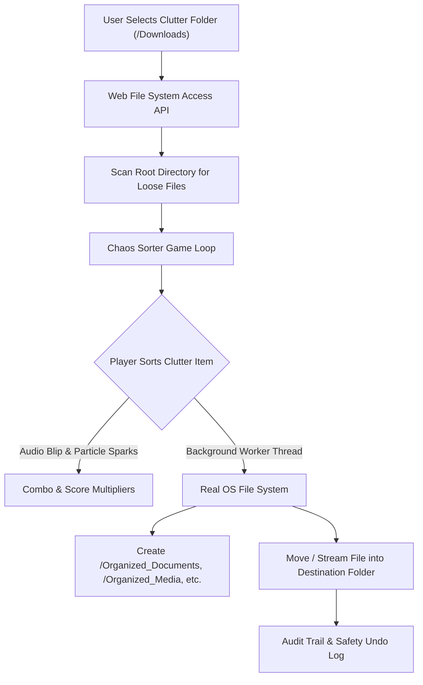

# ⚡ Chaos Sorter: The Desktop Dungeon

> **Transform the painful digital chore of cleaning messy folders into an addictive, fast-paced arcade game that executes real-world file organization in the background.**

[](https://vercel.com)
[](https://developer.mozilla.org/en-US/docs/Web/API/File_System_API)
[](https://developer.mozilla.org/en-US/docs/Web/API/Web_Audio_API)

---

## 💡 The Problem & The Solution

### The Challenge
> *"We all procrastinate on painful digital chores—cleaning out 5,000 unread emails, sorting messy folders, reviewing expenses, or fixing lint errors. Build an experience where playing a fast-paced game or interactive story actually executes the real-world chore in the background."*

### Our Solution
**Chaos Sorter** turns your disorganized `Downloads` or `Desktop` folder into a frantic sorting dungeon. Loose clutter items (PDF receipts, screenshots, installers, old code archives) appear as artifacts on a central conveyor belt. 

By slashing, launching, or keyboard-matching them into four dimensional portals (**[1] Documents**, **[2] Media**, **[3] Code**, **[4] Archives**, and **[Space] Review Bin**), you rack up combos, multipliers, and high scores. 

Crucially, **the game is not a simulation: in the background, the browser's native File System Access API actually creates structured directories and moves your real files on disk in real time.**

---

## 🎮 Core Game Mechanics

| Mechanic | How It Works |
| :--- | :--- |
| **Speed Sorting** | Match files to their destination portals before the combo gauge drains. |
| **Combo Multipliers** | 5-streak = **2X**, 10-streak = **4X**, 15-streak = **8X FRENZY MODE** with screen shake and particle bursts. |
| **Synthesized Audio** | 100% self-contained mathematical 8-bit sound effects synthesized via the Web Audio API (zero external asset latency). |
| **Multi-Input Controls** | Play with Keyboard (`1`-`4`, Arrow keys, `Space`), Touch buttons, or Drag-and-Drop gestures. |

---

## ⚙️ Architecture & Real-World Background Execution



---

## 🛡️ Safety Vault & Instant Undo (User Trust First)

When organizing real files, safety is non-negotiable:
* **Zero Accidental Deletions:** Files are never permanently erased; loose or temporary items are moved to an inspected `_Review_Bin/` directory.
* **Instant Undo:** Clicking **"Undo Last"** (`↩`) instantly pulls the moved file back into the root directory.
* **Audit Manifest Export:** Evaluators and users can export a cryptographic timestamped `.json` manifest of every single file moved.
* **Evaluator Sandbox Mode:** Evaluators testing on mobile or in restricted browsers can launch the **Instant Demo Sandbox** featuring 60 realistic clutter artifacts with 0 permissions needed.

---

## 🚀 Instant Local Setup

To preview and test the project locally:

```powershell
# Navigate into the project folder
cd C:\Users\HP\.gemini\antigravity\scratch\chaos-sorter

# Start local server with Python (which is already installed on your PC)
python -m http.server 3000
```
Open **[http://localhost:3000](http://localhost:3000)** in Google Chrome, Microsoft Edge, or Opera.

---

## 🌐 Deploy to Vercel in 2 Minutes

1. **Create a GitHub Repository:**
   ```bash
   git init
   git add .
   git commit -m "feat: initial release of Chaos Sorter"
   git branch -M main
   git remote add origin https://github.com/<YOUR_USERNAME>/chaos-sorter.git
   git push -u origin main
   ```

2. **Connect to Vercel:**
   * Go to [vercel.com](https://vercel.com) and log in with your GitHub account.
   * Click **"Add New Project"** and select **`chaos-sorter`**.
   * Leave all build settings as default and click **"Deploy"**.
   * Your project will be live with a production `.vercel.app` URL in under 30 seconds!

---

## 📝 License
MIT License. Built for the Hackathon Digital Chores Challenge.
