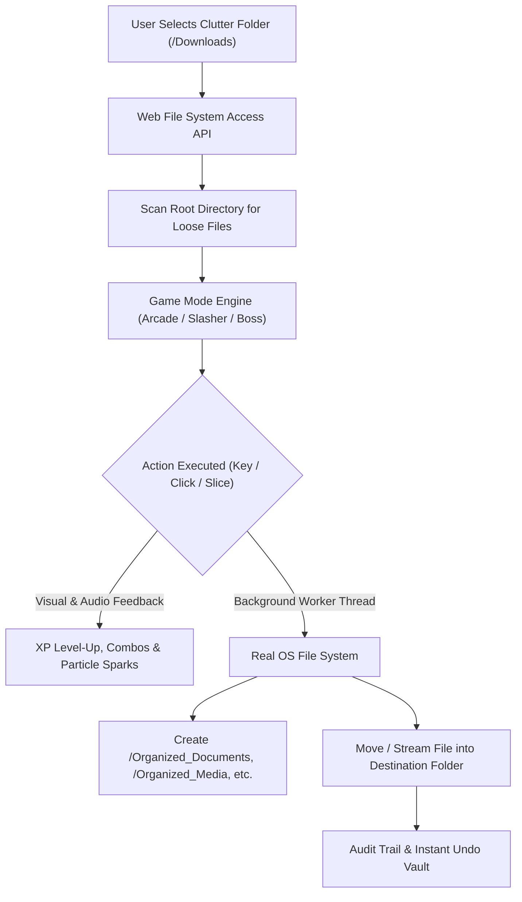

# ⚡ Chaos Sorter: The Desktop Dungeon

> **Transform the painful digital chore of cleaning cluttered folders into an addictive, feature-packed retro arcade experience with real background OS execution, fruit-ninja slicing mini-games, and RPG progression.**

[](https://developer.mozilla.org/en-US/docs/Web/API/File_System_API)
[](https://developer.mozilla.org/en-US/docs/Web/API/Web_Audio_API)
[](https://opensource.org/licenses/MIT)

---

## 💡 The Problem & The Solution

### The Challenge
> *"We all procrastinate on painful digital chores—cleaning out 5,000 unread emails, sorting messy folders, reviewing expenses, or fixing lint errors. Build an experience where playing a fast-paced game or interactive story actually executes the real-world chore in the background."*

### Our Solution
**Chaos Sorter** turns your disorganized `Downloads` or `Desktop` folder into a frantic, rewarding arcade dungeon. Loose clutter items (PDF receipts, screenshots, installers, old code archives) appear as artifacts across multiple interactive game modes:

1. 🕹️ **Arcade Speed Sorter:** High-velocity conveyor matching with dynamic combo multipliers (up to 8X Frenzy).
2. ⚔️ **Clutter Slasher (Mini-Game):** A *Fruit-Ninja* style airborne slicing experience where files fly in parabolas and are sliced in mid-air.
3. 👾 **Boss Clutter Rush:** A timed battle against the **"5GB Bloat Dragon"** where sorting large files inflicts direct damage on the boss monster.

Crucially, **the game is not a simulation: in the background, the browser's native Web File System Access API physically creates structured directories and organizes real files on your hard drive in real time.**

---

## 🎮 Core Features & Game Mechanics

| Feature | Description |
| :--- | :--- |
| **Real Background Execution** | Zero-latency, 100% private file sorting via native `window.showDirectoryPicker()` and `handle.move()`. |
| **3 Playable Game Modes** | Speed Sorter, Airborne Clutter Slasher, and Bloat Dragon Boss Rush. |
| **RPG Leveling & XP** | Earn XP per sorted file; level up from *Tidy Novice* (Lvl 1) to *Master of Order* (Lvl 5). |
| **Trophy Room & Badges** | 6 unlockable achievements with sound fanfares and +250 XP reward boosts. |
| **Dynamic Themes** | 4 selectable visual palettes: **Cyberpunk Neon**, **Synthwave 80s**, **The Matrix**, and **Midnight Gold**. |
| **Synthesized Audio** | 100% self-contained mathematical 8-bit sound effects synthesized via the Web Audio API (zero external asset latency). |
| **Safety Vault & Instant Undo** | Non-destructive sorting with a 1-click `Undo Last` mechanism and exportable cryptographic JSON audit manifests. |
| **Evaluator Sandbox Mode** | Instant 1-click simulation with 60 realistic clutter artifacts for zero-friction evaluation across any device or browser. |

---

## ⚙️ Architecture Diagram



---

## 🚀 Instant Local Setup

To preview and test the project locally:

```powershell
# Navigate into the project folder
cd "C:\Users\HP\.gemini\antigravity\scratch\chaos-sorter"

# Start local server with Python
python -m http.server 3000
```
Open **[http://localhost:3000](http://localhost:3000)** in Google Chrome, Microsoft Edge, or Opera.

---

## 📝 License
MIT License. Built for the Hackathon Digital Chores Challenge.
