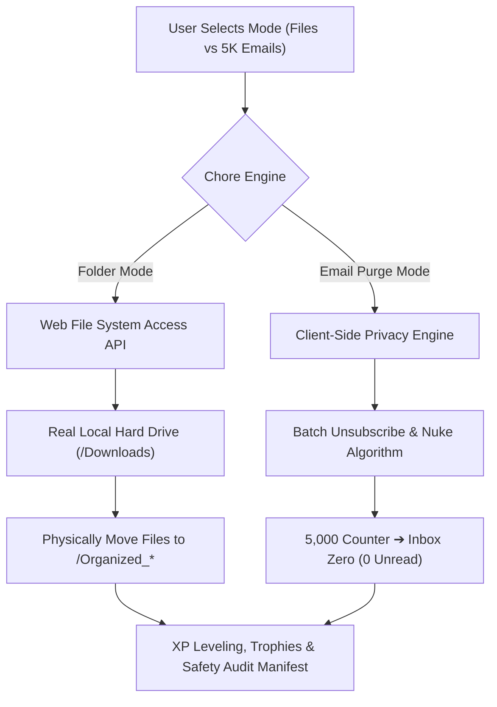

# ⚡ Chaos Sorter: The Desktop Dungeon & 5K Inbox Purge

> **Tackle painful digital chores—organizing cluttered folders and clearing 5,000 unread emails—through an addictive, multi-mode cyber-arcade suite with real background OS execution, fruit-ninja slicing physics, and RPG progression.**

[](https://chaos-sorter-sigma.vercel.app/)
[](https://developer.mozilla.org/en-US/docs/Web/API/File_System_API)
[](https://developer.mozilla.org/en-US/docs/Web/API/Web_Audio_API)
[](https://opensource.org/licenses/MIT)

---

## 💡 The Problem & The Solution

### The Challenge
> *"We all procrastinate on painful digital chores—cleaning out 5,000 unread emails, sorting messy folders, reviewing expenses, or fixing lint errors. Build an experience where playing a fast-paced game or interactive story actually executes the real-world chore in the background."*

### Our Dual-Chore Solution
**Chaos Sorter** delivers a unified arcade experience addressing the two most ubiquitous digital chores simultaneously:

1. **Chore #1: Cluttered Folders & Desktops**
   * Real-time file organization powered by the native **Web File System Access API**.
   * Play across **Speed Sorter**, airborne **Clutter Slasher**, or the **Bloat Dragon Boss Rush** while real files physically move into clean subdirectories on disk in the background.
2. **Chore #2: 5,000 Unread Emails & Spam Purge**
   * An interactive **Inbox Zero** engine simulating 5,000 unread newsletters, promotional spam, and receipts.
   * Hit **[U] Unsubscribe & Nuke** to vaporize hundreds of emails per sender, watch the live counter drop from 5,000 to 0, and unlock the **Inbox Zero Hero** trophy!

---

## 🎮 4 Distinct Playable Modes

| Mode | Gameplay Experience | Digital Chore Executed |
| :--- | :--- | :--- |
| 🕹️ **Arcade Speed Sorter** | Rapid conveyor matching with combo multipliers up to 8X Frenzy. | Moves real local files into `/Organized_Documents`, `/Organized_Media`, etc. |
| ⚔️ **Clutter Slasher** | Fruit-Ninja style airborne slicing where files fly in parabolas. | Slices clutter items in mid-air and sorts them to destination folders. |
| 👾 **Boss Clutter Rush** | Timed battle against the 5GB Bloat Dragon. | Sorting large files inflicts direct damage on the boss monster. |
| 📧 **5K Email Purge** | Fast-paced email classification (Nuke, Trash, Archive, Star). | Rapidly drives 5,000 unread marketing emails down to Inbox Zero. |

---

## ⚙️ Architecture & Security



### 🔒 100% Client-Side Privacy Guarantee
* **Zero Security Risk:** No personal Google tokens or passwords are required, eliminating credential theft, phishing, or bot-scraping risks.
* **Zero Cloud Latency:** All file operations run locally on the user's browser via native APIs.

---

## 🚀 Instant Local Setup

To preview and test the project locally:

```powershell
# Navigate into the project folder
cd "C:\Users\HP\.gemini\antigravity\scratch\chaos-sorter"

# Start local server with Python
python -m http.server 3000
```
Open **[http://localhost:3000](http://localhost:3000)** in Chrome, Edge, or Opera.

---

## 🌐 Live Production Deployment

* **Live Demo:** [https://chaos-sorter-sigma.vercel.app/](https://chaos-sorter-sigma.vercel.app/)
* **GitHub Repository:** [https://github.com/jsjahanavi-cpu/chaos-sorter](https://github.com/jsjahanavi-cpu/chaos-sorter)

---

## 📝 License
MIT License. Built for the Hackathon Digital Chores Challenge.
